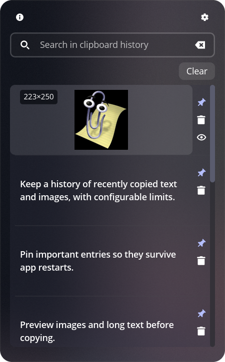
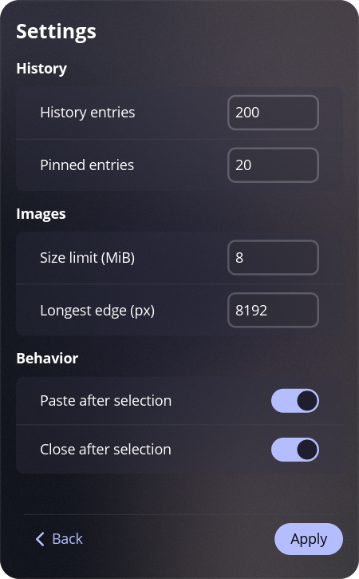
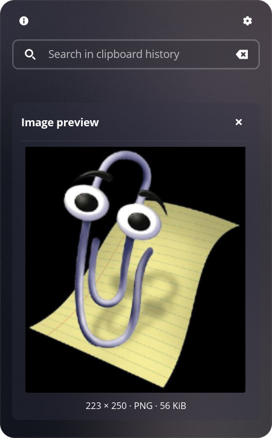
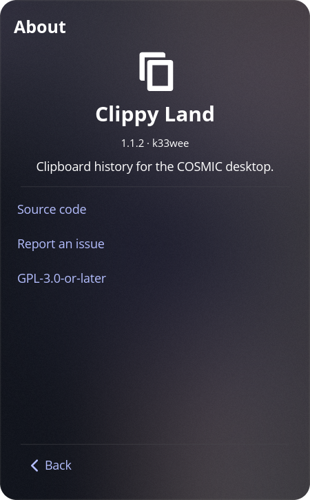
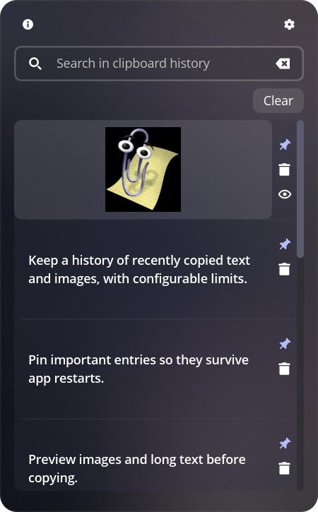

# clippy-land


COSMIC panel applet for keeping a history of recently copied text and images.

Search your clipboard, pin entries for later, and preview text or images before copying them.



## Usage

Install **Clippy Land** from [COSMIC Store](https://github.com/pop-os/cosmic-store)
under **COSMIC Applets**, or use one of the installation guides below.

Open **COSMIC Settings → Desktop → Panel → Applets** and add "Clippy Land" to your panel.
You might need to log out and back in to see the applet in the list of available applets.

Click the panel icon to open history. Select an entry to copy it and, by default,
paste it into the active app. Use the pin to keep an entry, the eye to preview it,
and the top-right gear to open Settings. You can also [set up a keyboard shortcut](#keyboard-shortcut).

## Guides

<details>
<summary>Features and keyboard controls</summary>

## Main features

- Keep a history of recent clipboard entries (text + images), with configurable limits
- Copy an entry with a single click or Enter, optionally paste it into the previously focused app, and auto-close the popup
- Remove individual entries from the history
- About and Settings sit above a full-width search field; a small, right-aligned **Clear** action below search removes only unpinned entries
- Pin important entries to the top of the history; pinned entries persist across app restarts (configurable pin limit)
- In-popup **Settings** panel to adjust limits and apply them immediately:
  - max history entries
  - max pinned entries
  - max image byte size
  - max image dimensions
  - paste into the active app after selection
  - close the popup after selection
- A unified history list with subtle separators and consistent text/image rows:
  - text entries show a bounded, four-line excerpt; URL styling remains copy-on-selection, and the eye button opens the existing full-text preview
  - larger contain-fit thumbnails and right-side row actions keep fixed geometry; original dimensions appear in an image badge on hover or keyboard focus, with format and file size in its tooltip
  - image rows have an eye button for a larger, contain-fit preview, decoded on demand with bounded memory
  - empty history and unmatched searches show a centered status and a helpful hint
- Move between entries with keyboard ( **up/down** or **k/j** to navigate rows; **left/right** or **h/l** to move between row actions: copy, preview (when available), pin, delete)
- Keyboard activation and escape behavior:
  - press **Enter** on an entry to copy it and, by default, paste it into the previously focused app
  - press **Enter** on the focused row action (including the preview eye button) to activate that action
  - while the text preview overlay is open, use **up/down** or **k/j** to scroll it
  - press **Q** to close either preview overlay
  - press **Esc** to return from a preview, Settings, or About to history; press it again to close the popup
- An **About** view shows the app version, author, source repository, issue tracker, and license
- Adds keyboard shortcuts for opening the history (see [Keyboard Shortcut](#keyboard-shortcut))

</details>

<details>
<summary>More screenshots</summary>

Screenshots use Clippy and feature descriptions as sample clipboard entries.
Colors follow your COSMIC theme. These captures use the local cosmic-panel blur fix currently being tested.

| Settings | Image preview |
| --- | --- |
|  |  |

| About | Frosted shortcut popup |
| --- | --- |
|  |  |

</details>

<details>
<summary>Install from COSMIC Store</summary>

## Cosmic Store

The applet is officially published on [Cosmic Store](https://github.com/pop-os/cosmic-store). In COSMIC Store it should be under the "COSMIC Applets" category.

If it does not show up in your app store, you'll need to add `cosmic-flatpak` as a source:

```sh
flatpak remote-add --if-not-exists --user cosmic https://apt.pop-os.org/cosmic/cosmic.flatpakrepo
```

Just install it from the store and you'll have the flatpak sandbox installed!

</details>

<details>
<summary>Set up a keyboard shortcut</summary>

## Keyboard Shortcut

You can open the clipboard history with a keyboard shortcut via the `--toggle` flag. The command uses the session D-Bus to notify the running applet without background polling.

Go to **COSMIC Settings → Keyboard → Custom Shortcuts**, add a new shortcut with:

- **Name:** Toggle ClippyLand
- **Command:** `cosmic-applet-clippy-land --toggle` (or `flatpak run io.github.k33wee.clippy-land --toggle` if installed via Flatpak)
- **Shortcut:** your preferred key combo (e.g. `Super+V`)

> **Note:** Due to a current limitation in the COSMIC panel, opening a popup without a pointer event (i.e. without actually clicking the applet icon) is not natively supported. As a workaround, `--toggle` opens the history as a layer surface rather than as the usual dropdown under the icon. When the focused window is known (via the `cosmic-toplevel-info` protocol), the visible popup appears near the center of that window, including when hosted by COSMIC Panel. Opposing layer-shell anchors and output-relative margins keep the actual surface near that window while working around the panel proxy's configure limitation. Otherwise it falls back to the top strip on the **active monitor** (the compositor tracks which output you are working on, even with no windows open). The desktop entry requests privileged compositor access with `X-HostWaylandDisplay=true`. When launched by a supporting COSMIC Panel, native and Flatpak applets share its granted connection for clipboard capture/publishing, focused-window tracking, and auto-paste. If that connection or the required protocols are unavailable (including a direct sandbox launch), the applet keeps the active-monitor placement fallback.

For local development, the binary also supports:

- `--standalone`: force open popup on startup
- `--no-standalone`: disable auto-open behavior

</details>

<details>
<summary>Settings, limits, and stored data</summary>

## Settings

You can open the in-popup settings panel with the top-right gear button. Compact rows group history, image, and behavior controls; hover a label for range or behavior details. Numeric changes use the fixed **Apply** button; behavior switches still save immediately.

Image size is displayed in **MiB** (0.25–64), while the existing configuration continues to store `max_image_bytes` in bytes. Fractional values are supported and opening/saving Settings preserves existing byte limits.

Settings are validated before apply/save. Current allowed ranges are:

- `max_history`: `30..=5000`
- `max_pinned`: `0..=500` and must be `<= max_history`
- `max_image_bytes`: `262144..=67108864`
- `max_image_dimension_px`: `512..=16384`
- `paste_on_action`: paste an activated entry with Ctrl+V, or Ctrl+Shift+V in recognized terminals
- `close_popup_on_action`: close the popup after activating an entry

By default, Clippy Land starts with:

- `paste_on_action = true`
- `close_popup_on_action = true`
- `max_history = 200`
- `max_pinned = 20`
- `max_image_bytes = 8 MiB`
- `max_image_dimension_px = 8192`

Config is stored at `~/.config/clippy-land/config.toml` (or `$XDG_CONFIG_HOME/clippy-land/config.toml`), and can be overridden with `CLIPPY_LAND_CONFIG`.

Auto-paste uses Ctrl+V for normal apps and Ctrl+Shift+V for recognized terminals (including COSMIC Terminal), selected from the focused window's app ID after closing the popup. This lets the terminal handle clipboard/bracketed paste into shells and nvim, rather than typing clipboard text as keystrokes. Unknown app IDs or unavailable toplevel tracking retain Ctrl+V; custom terminal keybindings may require manual paste. `wl-paste` only reads the clipboard and cannot paste into another window.

Auto-paste requires the compositor to expose the `zwp_virtual_keyboard_v1` Wayland protocol. If virtual-keyboard access is unavailable, Clippy Land still copies the entry and closes the popup, but does not inject a paste shortcut. COSMIC restricts this protocol on ordinary sandbox connections, but permits the privileged connection granted to panel applets. The grant is applet-level access, not a per-protocol permission dialog; no additional broad filesystem permission is needed. Without it, Flatpak installations retain the copy-only fallback.

Pinned clipboard entries are stored separately as app state so they survive app restarts and reboots. Only pinned entries are persisted; unpinned clipboard history remains runtime-only. Text pins are saved in a small TOML manifest, while pinned images store metadata in the manifest and image/thumbnail blobs beside it. By default, pinned history is stored at `$XDG_STATE_HOME/clippy-land/pinned-history.toml` or `~/.local/state/clippy-land/pinned-history.toml`, and can be overridden with `CLIPPY_LAND_PINNED_HISTORY`.

The **Clear History** action removes only unpinned entries. To remove a pinned entry, unpin it or delete that entry directly.

</details>

<details>
<summary>Install with Flatpak</summary>

## Install with Flatpak

1. Add the required remotes (if not already added):

```bash
flatpak remote-add --if-not-exists flathub https://flathub.org/repo/flathub.flatpakrepo
```

2. Download the latest `.flatpak` from the [releases page](https://github.com/k33wee/clippy-land/releases/).
3. In a terminal, navigate to the directory where you downloaded the `.flatpak` file and run:

```bash
flatpak install --user ./clippy-land_<version>.flatpak
```

This will install the applet for your user. If you encounter missing runtime errors, ensure the remotes above are added and try again.

</details>

<details>
<summary>Install for Debian/Ubuntu</summary>

## Install for Debian/Ubuntu

Download the latest .deb from the [releases page](https://github.com/k33wee/clippy-land/releases/):
In a terminal, navigate to the directory where you downloaded the .deb file and run:

```bash
sudo apt install ./cosmic-applet-clippy-land_<version>_amd64.deb
```

The packaged desktop entry now points directly at `/usr/bin/cosmic-applet-clippy-land`, so COSMIC will not accidentally launch an older binary from your `$PATH` during upgrades.

</details>

<details>
<summary>Install for Fedora</summary>

## Install for Fedora

Thanks to [lorduskordus](https://github.com/lorduskordus) there is now an RPM package on COPR.

- [copr.fedorainfracloud.org/coprs/kordus/cosmic-applets](https://copr.fedorainfracloud.org/coprs/kordus/cosmic-applets)

Traditional Fedora

```sh
sudo dnf copr enable kordus/cosmic-applets
sudo dnf install cosmic-applet-clippy-land
```

Fedora Atomic

```sh
sudo wget \
    https://copr.fedorainfracloud.org/coprs/kordus/cosmic-applets/repo/fedora/kordus-cosmic-applets.repo \
    -O /etc/yum.repos.d/_copr:copr.fedorainfracloud.org:kordus:cosmic-applets.repo
rpm-ostree install cosmic-applet-clippy-land
```

</details>

<details>
<summary>Build and install with just</summary>

## Build/Install with just

### Dependencies

- Wayland clipboard support (via `wl-clipboard-rs`)
- Build dependencies for libcosmic:

```bash
sudo apt install cargo cmake just libexpat1-dev libfontconfig-dev libfreetype-dev libxkbcommon-dev pkgconf
```

```bash
# build
just build

# install system-wide under /usr
sudo just install

# uninstall the system-wide source install
sudo just uninstall
```

`just install` now renders the desktop entry with an absolute `Exec=` path for the chosen prefix, so the applet launcher stays tied to that exact install instead of whichever `cosmic-applet-clippy-land` happens to appear first in `$PATH`.

</details>

<details>
<summary>Run the tests</summary>

## Testing

Use the provided `just` recipes:

```bash
# unit/integration tests
just test

# tests intended for Wayland runtime environments
just test-wayland

# end-to-end Wayland interaction checks
just e2e
```

E2E tests require a Wayland session and helper tools such as `wl-copy`, `wl-paste`, and `wtype`.

</details>

<details>
<summary>Custom install paths and cleanup</summary>

## Install with custom paths

Pass a `prefix` variable to install everything under a custom root:

```bash
# install under ~/.local for the current user without sudo
just prefix="$HOME/.local" install

# uninstall the current user's ~/.local source install
just uninstall-user

# equivalent explicit form
just prefix="$HOME/.local" uninstall
```

If an older user-local install was created with `sudo just prefix=~/.local install`, its files may be owned by root. Remove that old root-owned local install once with `sudo just prefix="$HOME/.local" uninstall`, then use the non-sudo `~/.local` commands above for future user-local installs.

All paths are derived from `prefix`:

| Path                                         | Default                  |
| -------------------------------------------- | ------------------------ |
| `<prefix>/bin`                               | binary + launcher script |
| `<prefix>/share/applications`                | `.desktop` file          |
| `<prefix>/share/icons/hicolor/scalable/apps` | app icon                 |
| `<prefix>/share/metainfo`                    | MetaInfo file            |
| `<prefix>/share/licenses/<appid>`            | license                  |

If you previously installed Clippy Land under `~/.local` and then switched to the `.deb` or another system install, remove the older user-local install first with `just uninstall-user`. Per the desktop entry spec, a user-local desktop file with the same ID overrides the system one, and older applet installs could also leave behind a stale `~/.local/bin/cosmic-applet-clippy-land` binary.

</details>

<details>
<summary>Technical notes</summary>

## Notes

This applet listens for Wayland data-control selection events and updates the
history only when the clipboard contents change.

- App ID is currently `io.github.k33wee.clippy-land`.
- Debug wrapper log path defaults to `${XDG_STATE_HOME:-$HOME/.local/state}/clippy-land/panel-debug.log`.

</details>

## Contributing docs

- For issue reporting and panel-log collection, see [DEBUGGING.md](./DEBUGGING.md).
- For adding or updating translations, see [TRANSLATION.md](./TRANSLATION.md).

## Attribution

- "Cosmic Icons" by System76 is licensed under CC-SA-4.0
